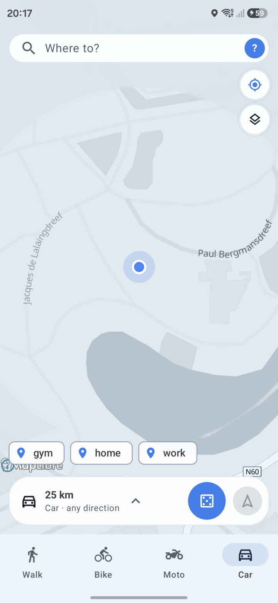
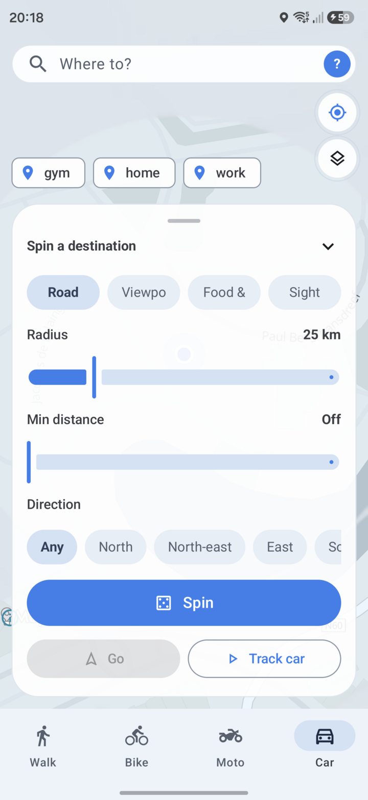
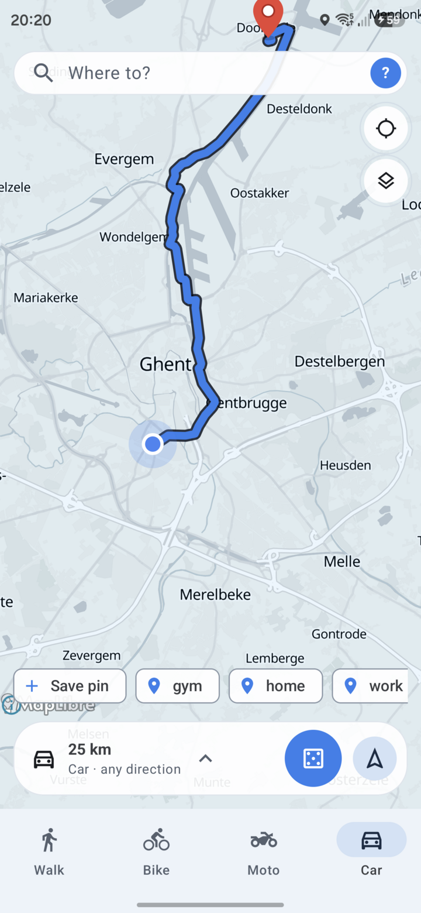

# Detour

Don't know where to drive? Set a radius, spin, get a random point on a real road, and go.

<table>
  <tr>
    <td align="center"> The map</td>
    <td align="center"> Set up a spin</td>
    <td align="center"> A destination, routed</td>
  </tr>
</table>

Screenshots were taken on a phone running a throwaway profile: synthetic
trips, invented saved places and a mocked GPS position around Ghent. Nothing in
them is a real location.

## Start here

| You are | Read |
| --- | --- |
| **A rider** | **[Install](docs/USER_GUIDE.md#install)**, then the **[user guide](docs/USER_GUIDE.md)**: every screen, every setting |
| **A developer** | **[docs/DEVELOPERS.md](docs/DEVELOPERS.md)** for prerequisites, layout, build and running the stack; [CONTRIBUTING.md](CONTRIBUTING.md) for branches, PRs, versioning, review and style |
| **A hoster** | **[docker/prod/README.md](docker/prod/README.md)** to stand the server up; [backend/INSTALL.md](backend/INSTALL.md) for every configuration key |

How it all fits together is [docs/ARCHITECTURE.md](docs/ARCHITECTURE.md). For
anything else, [docs/README.md](docs/README.md) is the full index.

The app itself works with **no account and no server**: spin, route hand-off,
trip recording, fog of war and badges are all local. A server buys sign-in, sync
across devices, friends, convoys and circles. In-app turn-by-turn buys a router.
Nothing published here has a server address baked in — you point the app at your
own under Settings.

## Security and privacy

[SECURITY.md](SECURITY.md) is what is in scope and how to report privately.
[docs/USER_GUIDE.md § What leaves your device](docs/USER_GUIDE.md#what-leaves-your-device)
is the plain-language version of every network call the app makes;
[docs/privacy.html](docs/privacy.html) is the published policy.

## Support

Detour is free, MIT-licensed and unlocked. Nothing is behind a paywall and
supporting it buys no perks. If you want to help it keep going, that is welcome.

The current goal is **bringing Detour to iPhone**. The iOS app does not exist
as a usable build yet: I develop on Linux and can only verify iOS through CI,
which is too slow to build it properly. Funding goes to, in order:

1. A secondhand Mac and iPhone to build and test on, roughly €600–900.
2. The Apple Developer Program, $99 a year, needed for TestFlight and the App
   Store.
3. Anything beyond that goes to a **public test server**, so you can try sync,
   friends and convoys without self-hosting. It would be best-effort: no uptime
   promise, and data may be wiped.

If the goal is not reached, the money still goes to the same list. There is no
date for iOS. Progress notes will be posted in the repo as each step lands.

**[Sponsor Detour on GitHub](https://github.com/sponsors/Detour-app)**

## Attribution

Map data © [OpenStreetMap](https://www.openstreetmap.org/copyright)
contributors, [ODbL](https://opendatacommons.org/licenses/odbl/). Spin
destinations, speed cameras and coverage are all derived from OpenStreetMap via
the Overpass API. Map tiles by [OpenFreeMap](https://openfreemap.org/). Geocoding
by [Photon](https://photon.komoot.io) (komoot) when the public fallback is used.
Routing by [GraphHopper](https://www.graphhopper.com/). Identity by
[Keycloak](https://www.keycloak.org/).
