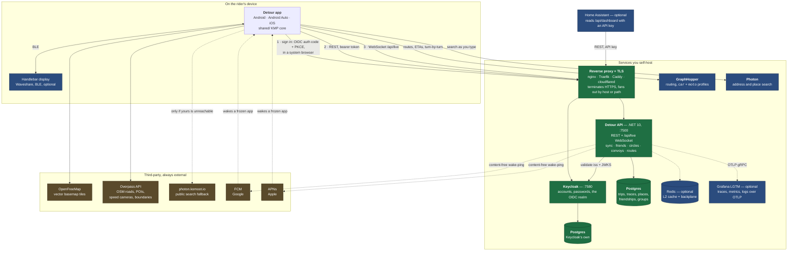
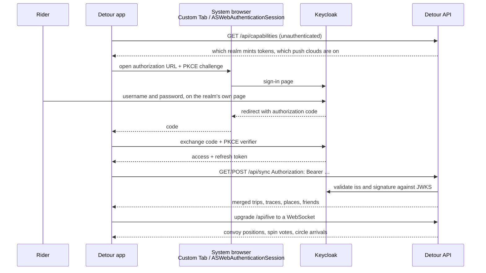

# Detour: architecture

The shape of the whole system: every service, what it is for, and how they
connect. Standing it up is [docker/prod/README.md](../docker/prod/README.md).

Detour is a Kotlin Multiplatform core wrapped in two apps, talking to **up to
eight services you run yourself** and a handful of third-party ones. Only the
first three of yours are needed for an account to work at all.

## Every service, and what it is for

Green in the diagram is required for an account; blue is optional; brown is
somebody else's.

| Service | What it does | Required? | Without it | Runs from |
| --- | --- | --- | --- | --- |
| **Detour API** | The one service this repo *is*: trip and trace sync, saved places, friendships, convoys, circles, shared routes, the live WebSocket relay, and the read-only dashboard endpoints. .NET 10, listens on 7500, applies its own migrations at startup. | Yes, for an account | No sign-in, no sync, no friends, circles or convoys. The app is fully usable locally. | `docker/prod/docker-compose.yml` (the base layer), or `ghcr.io/detour-app/detour-api` |
| **Postgres** (app) | Everything the API stores. Needs the real thing, not SQLite: `citext` handles, `jsonb` columns, real unique indexes. | Yes | The API will not start. | base layer, alongside the API |
| **Keycloak** | Owns accounts and passwords. Detour has no registration form, no password form and no invite codes — sign-in happens on the realm's own page in a browser, and the API only ever sees the token it issued. | Yes | Nobody can sign in; there is no local fallback. | add `docker-compose.idp.yml` to `COMPOSE_FILE`, or point `IDP_ISSUER` at your own realm |
| **Postgres** (Keycloak) | Keycloak's own store, deliberately a second instance: separate product, separate upgrade cadence, and restoring one must never involve the other. | Yes | Losing it loses every login. | `docker-compose.idp.yml`, with Keycloak |
| **Reverse proxy with TLS** | Terminates HTTPS and fronts the API and Keycloak. The realm issues tokens against **one fixed issuer URL**, and that URL should be `https`. The prod compose binds everything to `127.0.0.1` on the assumption something sits in front. | In practice, yes | Tokens are issued against a plain-HTTP issuer, and mobile clients are unhappy about it. | Your choice. Overlays ship for [nginx](../docker/prod/docker-compose.proxy.yml) and [Cloudflare Tunnel](../docker/prod/docker-compose.cloudflare.yml); Traefik and Caddy work equally well |
| **GraphHopper** | Turn-by-turn routing, and the routed (rather than straight-line) distance and ETA on spin candidates. Must expose profiles named exactly `car` and `moto`. | No | "Navigate in app" is *absent*, not degraded, and spin candidates fall back to crow-flies distance. | add `docker-compose.routing.yml` to `COMPOSE_FILE` — GraphHopper 11, region-driven, with a first-boot graph build (tens of minutes, RAM-hungry). See [docker/prod/README.md](../docker/prod/README.md#the-layers) |
| **Photon** | Address and place search. | No | Search silently uses the public `photon.komoot.io` instead — unless you turn the fallback off. | add `docker-compose.search.yml` to `COMPOSE_FILE` — one country per `PHOTON_REGION`. See [docker/prod/README.md](../docker/prod/README.md#the-layers) |
| **Redis** | L2 cache behind FusionCache, plus its backplane. Empty config is a *correct* single-instance deployment. | No | A cache miss is a slower request, not a broken one. Wire it when you run more than one API container. | `--profile cache` on the base layer |
| **Grafana LGTM** | Grafana, Loki, Tempo, Prometheus and an OTel collector in one container. The API exports over OTLP. | No | No traces, metrics or logs dashboard. | `docker/dev` only — production picks its own |
| **Home Assistant** | Optional consumer, not part of the stack: lifetime totals, badges and recent rides as HA entities, read from `/api/dashboard/*` with a dashboard API key that can only ever read its own owner's data. | No | — | [server/homeassistant/](../server/homeassistant/README.md) |

Third-party, contacted by the **app** rather than by your server:

| Service | For | Notes |
| --- | --- | --- |
| **OpenFreeMap** | Vector basemap tiles | Sees your current map viewport |
| **Overpass API** | The OSM data behind spins, POIs, speed cameras and coverage boundaries | Sees the spin centre and radius you choose. Two public endpoints are used in rotation |
| **photon.komoot.io** | Search and place naming, when you have no Photon of your own or yours is down | Sees your query and an approximate location, and the exact coordinates of spin destinations and unnamed route stops (tapped or GPX-imported) it names. Turn the fallback off to keep search on your own hardware |
| **FCM / APNs** | The content-free circle wake-ping | Your server talks to these, not the app. Both optional; without them circles still deliver over the socket and the catch-up sweep. See [docs/PUSH.md](PUSH.md) |

## How the pieces connect

**Everything the app sends goes over HTTPS**, and the app addresses each service
directly — the API, the router and the geocoder are three independent addresses
in Settings, with one `url` covering them all only when a single host path-routes
to all three. The sign-in realm is announced by the API server rather than typed
(an address saved by an older version still wins), and deliberately never falls
back to the others.

Sign-in is standard OIDC authorization-code with PKCE, run in a **system
browser** rather than in the app, so Detour never sees a password:

Two consequences worth knowing before you deploy:

- **The issuer URL is load-bearing.** The API requires an exact `iss` claim, not
  a prefix, and Keycloak builds it from `KC_HOSTNAME` plus `/realms/<realm>`.
  Changing it invalidates every issued token and every stored redirect URI.
- **Keycloak must not sit behind an authenticating gateway** such as Cloudflare
  Access. The token exchange has no way to answer the challenge, and sign-in
  fails in a way that looks like a client bug. See
  [docker/prod/CLOUDFLARE.md](../docker/prod/CLOUDFLARE.md).

The live relay is a single WebSocket at `/api/live`, shared by convoys and
circles. Convoy positions are relayed between open sockets and **never written
down**; a circle keeps exactly one row per member — the latest fix, overwritten
in place, no history and no trail. Push-to-talk frames are accepted off the wire
and dropped: voice is deferred, not broken, and will come back as Opus over
binary frames rather than the raw PCM base64'd into JSON that cost roughly
40 KB/s per talker per listener. The wire format of every frame is
[docs/CIRCLES_AND_CONVOYS.md](CIRCLES_AND_CONVOYS.md).

Behind a proxy, **name the proxy** — set `ForwardedHeaders__KnownNetworks` or
`__KnownProxies`. Both are empty by default, which makes the API ignore
`X-Forwarded-*` entirely; that is the safe default and the wrong one once
anything sits in front, because every caller then shares a single rate-limit
bucket keyed on the proxy's address. [backend/INSTALL.md](../backend/INSTALL.md#behind-a-reverse-proxy)
has the detail, including why clearing the lists to "trust everything" is worse
than leaving them empty.

## Stack

**Kotlin Multiplatform.** The roulette draw, routing, trip recording, badges,
coverage and sync all live in `shared/` as `commonMain`, compiled for Android and
iOS alike. Ktor for HTTP (OkHttp on Android, NSURLSession on iOS),
kotlinx-serialization, kotlinx-datetime and okio. The core is handed its location
fixes, audio and Bluetooth by whichever platform is running it — it never reaches
for them — which is why only three things are `expect`.

**Android** (`app/`): Jetpack Compose, Material 3, MapLibre GL, fused location
provider, Android for Cars App Library. Min SDK 26.

**iOS** (`iosApp/`): SwiftUI, MapLibre GL Native, CoreLocation,
`CMMotionActivityManager` for the automotive hint and `CMDeviceMotion` for lean
and g. Targets iOS 17.

**Backend** (`backend/`): .NET 10, ASP.NET Core, EF Core on Postgres, Keycloak for
identity, FusionCache with an optional Redis L2, OpenTelemetry throughout. Domain
never references Database; Api is the only project that knows about ASP.NET Core.

Trips and traces are stored as JSON in app-private storage on the device, and
synced as records only their owner can read.
